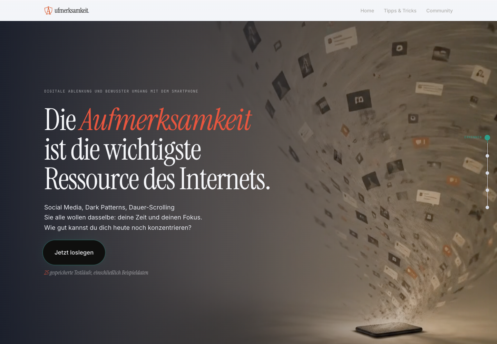
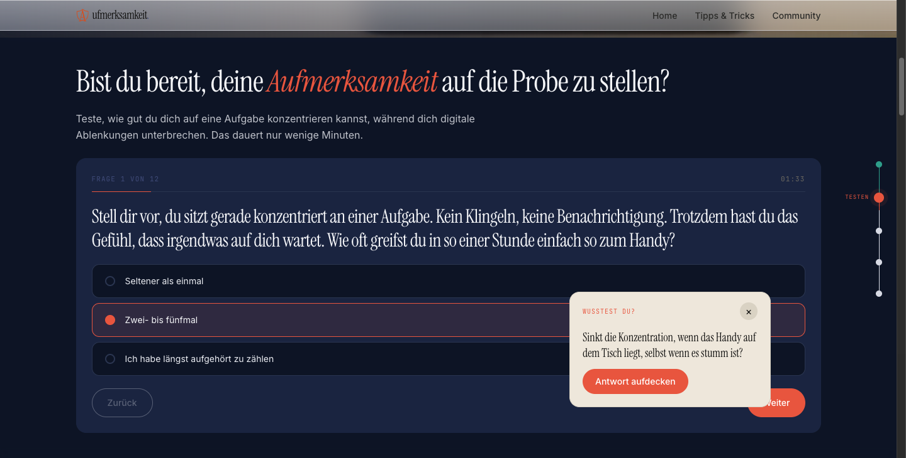
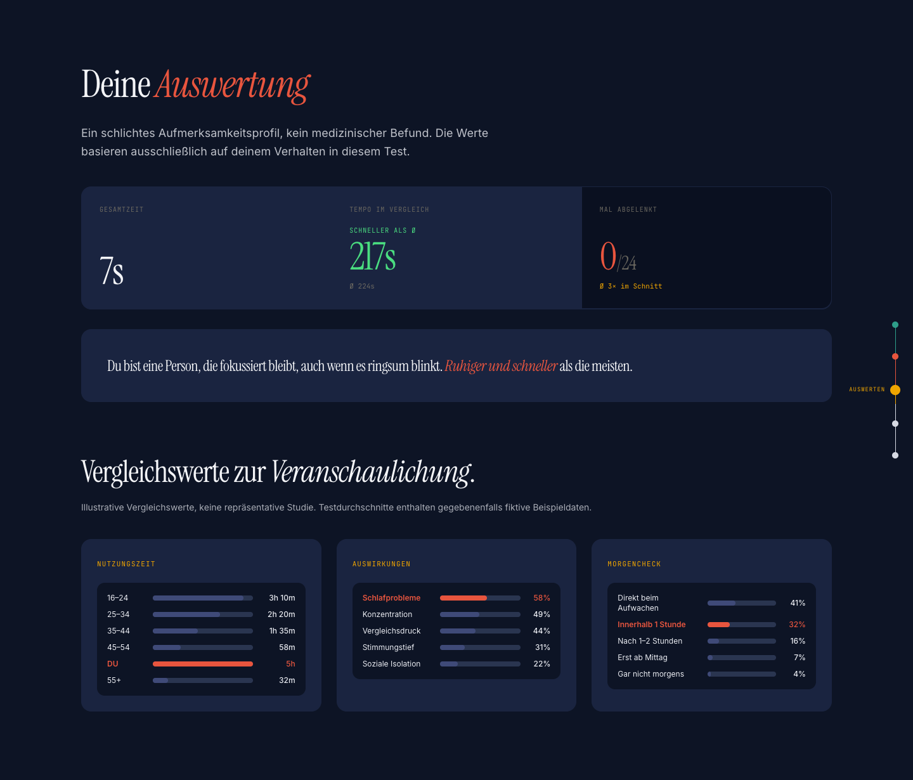
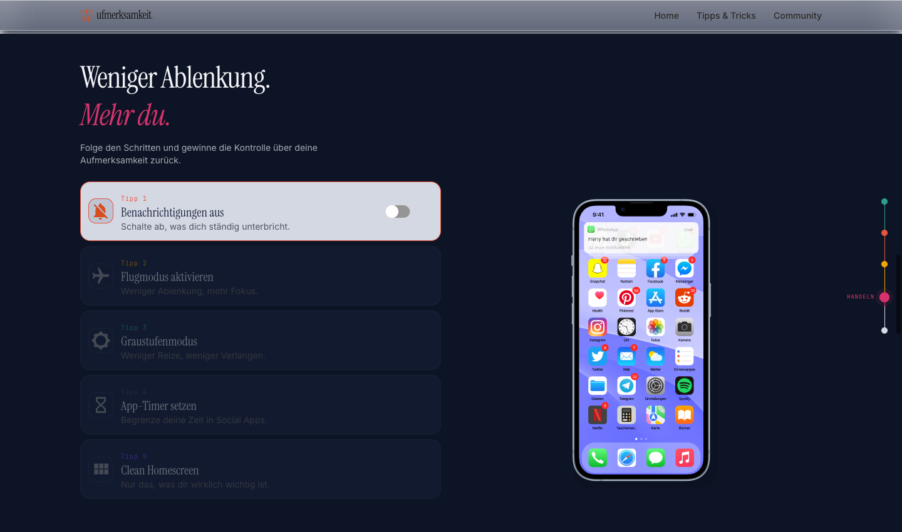
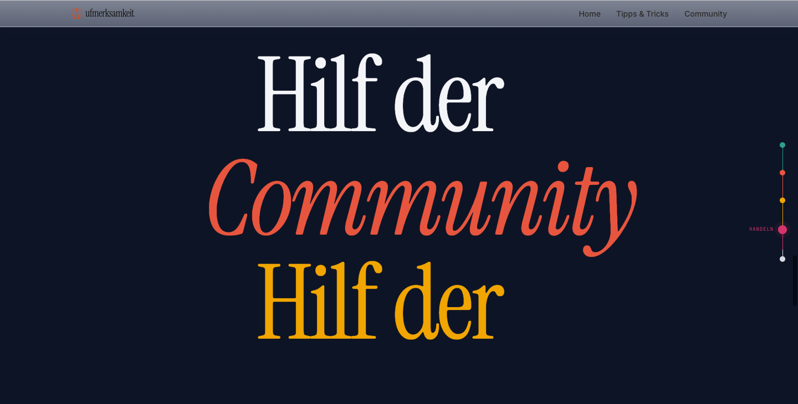
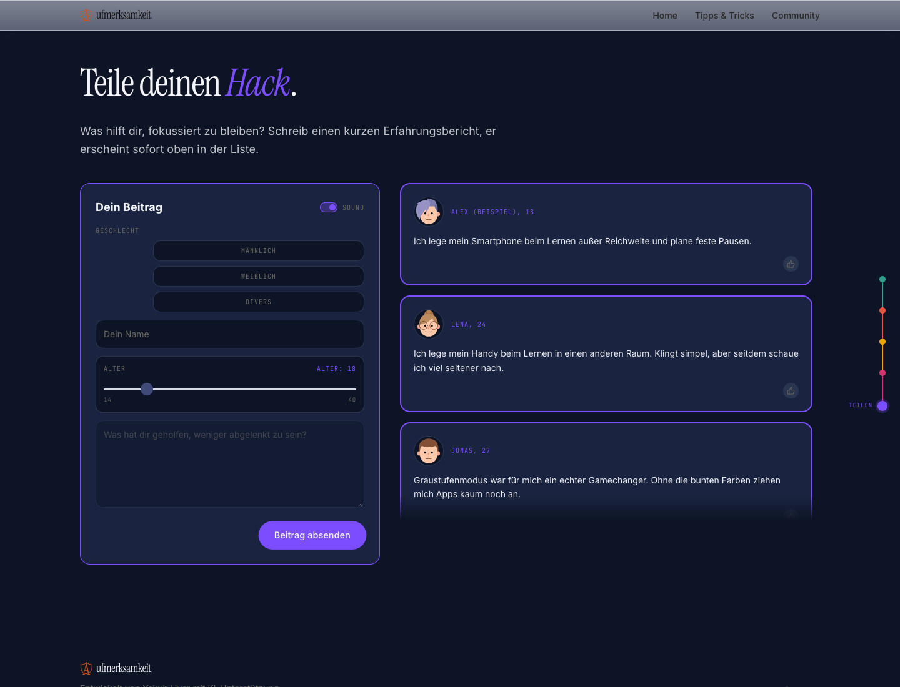

# Aufmerksamkeit

**Eine interaktive Webanwendung über digitale Ablenkung und bewussten Umgang mit dem Smartphone.**

[English](README.en.md) · [Lizenz](LICENSE) · [Urheber und Materialien](docs/ATTRIBUTION.md)

Aufmerksamkeit verbindet einen kurzen Selbstreflexions-Test mit absichtlich eingebauten Ablenkungen, einer persönlichen Auswertung, animierten Tipps und einem Community-Bereich. Die Anwendung macht typische Mechanismen der Aufmerksamkeitsökonomie erfahrbar. Sie richtet sich an Menschen, die ihre digitalen Gewohnheiten hinterfragen möchten.

**Yakub Uyar** entwickelte die Anwendung, einschließlich Datenbank, API und Rive-Einbindung mit Zustandssteuerung. Die Rive-Gestaltung ist ein anonymer Beitrag, siehe [Urheberhinweise](docs/ATTRIBUTION.md).

## Einblicke

Die Aufnahmen zeigen die tatsächlich laufende deutsche Oberfläche mit fiktiven Beispieldaten.

### Einstieg



### Test mit Ablenkungen



### Auswertung



### Interaktive Tipps



### Einladung zur Community



### Community



## Funktionen

- Fragebogen mit zwölf Fragen, Zeitmessung und gezielt angebotenen Ablenkungen
- Persönliche Auswertung mit bearbeiteten Fragen, geöffneten Ablenkungen und Bearbeitungsdauer
- Vergleich mit den in der jeweiligen Datenbank gespeicherten Durchläufen
- Fünf interaktive Smartphone-Tipps mit Rive-Zustandsmaschinen
- Community-Beiträge mit Name beziehungsweise Pseudonym, Alter, Geschlechtsauswahl und Likes
- Speicherung von Beiträgen, Likes und zusammengefassten Testergebnissen in PostgreSQL

Der Fragebogen dient der Selbstreflexion. Er ist weder ein medizinischer Test noch ein wissenschaftlich validiertes Messinstrument. Die Vergleichsgrafiken zu digitalen Gewohnheiten sind illustrative Inhalte, keine durch dieses Projekt erhobene repräsentative Studie.

## Technik und Entscheidungen

| Bereich | Umsetzung |
| --- | --- |
| Webanwendung | Next.js 16 mit App Router und React 19; Oberfläche und API liegen in einem Projekt. |
| Oberfläche | TypeScript, Tailwind CSS 4, Framer Motion und Lenis für Gestaltung, Übergänge und Scroll-Verhalten. |
| Animationen | Rive mit React Canvas; Benutzereingaben steuern Zustände, Trigger und Figuren. |
| Daten | PostgreSQL 16 und Prisma 6 mit versionierten Migrationen. |
| Likes | Ein Session-Cookie ordnet Likes einem Browser zu; ein eindeutiger Datenbankindex verhindert doppelte Likes derselben Session. |
| Einrichtung | Docker Compose startet Webanwendung und Datenbank; Daten bleiben in einem benannten Volume erhalten. |

## Lokal starten

Voraussetzung: Docker mit Docker Compose, beispielsweise Docker Desktop. Docker muss laufen. Der erste Build benötigt Internet für Pakete und Schriften.

```sh
git clone https://github.com/Yakub-Tech/Aufmerksamkeit.git
cd Aufmerksamkeit
cp .env.example .env
docker compose up -d --build
```

Danach [http://localhost:3000](http://localhost:3000) öffnen. Migrationen werden beim Containerstart ausgeführt. Die Beispieldaten werden standardmäßig angelegt: 25 fiktive Testdurchläufe und fünf fiktive Beiträge. Die sichtbaren Summen und Durchschnittswerte enthalten diese Beispieldaten und sind keine nachgewiesenen Nutzerzahlen. Mit `SEED_DEMO=false` in `.env` lässt sich das automatische Anlegen für eine neue Datenbank abschalten; vorhandene Beispieldaten werden dadurch nicht gelöscht.

Die Zugangsdaten in `.env.example` sind ausschließlich lokale Beispielwerte. Für andere Umgebungen eigene Werte setzen und `DATABASE_URL` konsistent anpassen. `.env` wird nicht veröffentlicht. `SESSION_COOKIE_SECURE=false` gilt ausschließlich für den lokalen HTTP-Start. Bei Betrieb mit HTTPS muss `SESSION_COOKIE_SECURE=true` gesetzt sein; ein Produktionsstart außerhalb von Compose setzt ohne diesen Override sichere Cookies voraus. Die Compose-Konfiguration bindet die Webseite nur an den lokalen Rechner; PostgreSQL hat keinen veröffentlichten Port.

```sh
docker compose logs -f web  # Start und Fehler prüfen
docker compose down        # Stoppen; Daten bleiben erhalten
docker compose up -d       # Vorhandene Container wieder starten
```

`docker compose down -v` löscht die gespeicherten Daten. Nur für eine ausdrücklich gewünschte Rücksetzung einer entbehrlichen Testumgebung verwenden.

## Bestehende Datenbank übernehmen

Ältere Versionen legten Tabellen mit `prisma db push` an. Bei einer solchen gefüllten Datenbank ohne Migrationstabelle `_prisma_migrations` bricht `migrate deploy` mit P3005 ab. Neue, leere Datenbanken benötigen die folgenden Schritte nicht.

Vor einer Übernahme die bisherigen `POSTGRES_*`-Zugangsdaten, die dazu passende `DATABASE_URL` und das vorhandene Datenbank-Volume beibehalten. Auch der Compose-Projektname muss unverändert bleiben, damit dasselbe Volume verwendet wird. Die Beispielwerte nicht über die bisherigen Zugangsdaten kopieren. `SEED_DEMO=false` verhindert das zusätzliche Anlegen von Beispieldaten.

Zunächst den Webcontainer stoppen, eine Sicherung außerhalb des Repositorys erstellen und das vorhandene Schema anzeigen:

```sh
docker compose stop web
docker compose up -d db
docker compose exec -T db sh -c 'pg_dump -U "$POSTGRES_USER" -d "$POSTGRES_DB" --format=custom' > ~/Aufmerksamkeit-backup.dump
docker compose build web
docker compose run --rm --no-deps web npx prisma db pull --print
```

Die Sicherung enthält die Datenbank, keine `.env`-Datei. Zugangsdaten separat sicher aufbewahren und die Wiederherstellung mit PostgreSQL-Werkzeugen in einer getrennten Datenbank prüfen.

**Nur fortfahren, wenn keine `_prisma_migrations`-Tabelle existiert und das angezeigte Schema dem bekannten bisherigen Stand entspricht:** `Comment` einschließlich `gender`, `CommentLike` mit eindeutiger Kombination aus Session und Beitrag sowie `TestStat` und `TestResult`, jeweils mit den Spalten und Beziehungen aus `prisma/schema.prisma`. Bei einem abweichenden Schema oder vorhandener Migrationshistorie ist eine gesonderte Prüfung nötig.

Für genau diesen Stand werden die drei bereits im Schema enthaltenen Migrationen als angewendet vermerkt. Anschließend wird die neue Migration für das vollständige Schema ausgeführt:

```sh
docker compose run --rm --no-deps web npx prisma migrate resolve --applied 20260429093119_initial_schema
docker compose run --rm --no-deps web npx prisma migrate resolve --applied 20260518122635_add_likes_to_comment
docker compose run --rm --no-deps web npx prisma migrate resolve --applied 20260531124607_add_gender
docker compose run --rm --no-deps web npx prisma migrate deploy
docker compose up -d web
```

Dieser Ablauf wurde an einer isolierten Datenbank mit dem bisherigen `db push`-Schema geprüft; ein vorhandener Beispielbeitrag blieb unverändert. Das ersetzt keine Prüfung der eigenen Datenbank. Das Volume nicht löschen und bei Fehlern die Webanwendung gestoppt lassen, bis Schema und Migrationen geklärt sind.

## Entwicklung und Prüfungen

Voraussetzungen: Node.js 22, npm und eine erreichbare PostgreSQL-16-Datenbank. Für Entwicklung außerhalb des Webcontainers muss `DATABASE_URL` auf die tatsächlich erreichbare Datenbankadresse zeigen; der Compose-Hostname `db` funktioniert nur im Compose-Netzwerk.

Für eine lokale Entwicklungsdatenbank kann die vorhandene Compose-Konfiguration mit dem Port-Override verwendet werden:

```sh
docker compose -f docker-compose.yml -f compose.dev.yml up -d db
```

Dazu in `.env` nur den Datenbankhost in `DATABASE_URL` von `db` auf `localhost` ändern. Benutzer, Passwort und Datenbankname bleiben passend zu den `POSTGRES_*`-Werten. Der Override veröffentlicht PostgreSQL ausschließlich auf `127.0.0.1:5432`. Eine vorhandene lokale Datenbank auf diesem Port muss vorher gestoppt oder ein anderer Port passend eingerichtet werden. Einen gegebenenfalls laufenden Webcontainer mit `docker compose stop web` stoppen, damit Port 3000 frei ist. Die Webanwendung anschließend außerhalb von Docker starten:

```sh
npm ci
npx prisma generate
npm run prisma:migrate
npm run prisma:seed  # optional: ausschließlich fiktive Beispieldaten
npm run dev
```

Der Entwicklungsserver läuft auf Port 3000. Für den späteren Webbetrieb mit Docker in `DATABASE_URL` wieder den Host `db` verwenden. Die `.env` wird von Next.js und Prisma gelesen. Für einen lokalen Produktionsstart:

```sh
npm run lint
npm run build
npm start
```

Die API-Tests benötigen eine separat gestartete Anwendung mit einer entbehrlichen Testdatenbank. **Die Tests schreiben Beiträge, Likes und Testergebnisse. Sie dürfen nicht gegen eine produktive Installation laufen.**

```sh
TEST_BASE_URL=http://127.0.0.1:3000 npm test
```

GitHub Actions installiert die Pakete aus der Lockdatei, führt Lint, die Sicherheitsprüfung der Produktionsabhängigkeiten und den Build aus und prüft die API gegen eine isolierte PostgreSQL-Datenbank. Diese Prüfungen ersetzen keinen vollständigen Sicherheits-, Barrierefreiheits- oder Lasttest.

Der gezielte npm-Override für `@prisma/config` verwendet `deepmerge-ts` 8.0.2, um ein Stack-Overflow-Problem der Prisma-CLI zu vermeiden. Einzelne Sicherheitsmeldungen betreffen weiterhin Entwicklungswerkzeuge. Lint und ähnliche Werkzeuge deshalb nur auf vertrauenswürdigen Projektdateien ausführen; die Produktionsprüfung wird separat mit `npm audit --omit=dev` ausgeführt.

## Projektstruktur

```text
app/                Seite, Layout und Next.js-API-Routen
components/         Test, Auswertung, Tipps und Community-Oberfläche
hooks/              Gemeinsame React-Hooks
lib/                Prisma-Client, Session-Cookie und Hilfsfunktion für Asset-URLs
prisma/             Schema, Migrationen und fiktive Beispieldaten
public/             Lokal bereitgestellte Animationen und Medien
assets/screenshots/ Echte Aufnahmen für die Dokumentation
test/               API-Integrationstests und Regressionstest für Asset-URLs
```

## Bedienung und Grenzen

1. Auf der Startseite „Jetzt loslegen“ auswählen.
2. Die zwölf Fragen beantworten. Ablenkungskarten können geöffnet werden und werden separat gezählt.
3. Die Auswertung ansehen und anschließend die Smartphone-Tipps ausprobieren.
4. Im Community-Bereich einen fiktiven Beitrag schreiben und Likes hinzufügen oder entfernen.

Es gibt keine Benutzerkonten, Administratoroberfläche oder Beitragsmoderation. Ein Like ist einem Browser-Cookie zugeordnet, keiner verifizierten Person. Testergebnisse sind freiwillig übermittelte Werte und keine manipulationssichere Statistik. Einzelne Fragebogenantworten bleiben im Browser; der Server speichert Bearbeitungsdauer und Anzahl geöffneter Ablenkungen.

Community-Beiträge sind für alle Besucher der jeweiligen Installation sichtbar. Name, Alter und Geschlechtsauswahl sollten daher nur fiktive Beispieldaten sein. Das Community-Formular verlangt eine Geschlechtsauswahl, die auch die animierte Figur bestimmt. Die Anwendung setzt ein langlebiges Session-Cookie für Likes. Die API validiert Eingaben, enthält jedoch keine umfassende Spam-Abwehr, Zugangskontrolle oder Datenschutzverwaltung. Vor einem öffentlichen Betrieb müssen Betreiber insbesondere Moderation, Missbrauchsschutz, Löschmöglichkeiten, Datenschutzinformationen, HTTPS, Zugriffsrechte und Datensicherung passend zum tatsächlichen Einsatz klären und umsetzen. Eine öffentliche Live-Demo ist nicht Bestandteil dieser Veröffentlichung.

Die Datenbank liegt im Docker-Volume. Für Daten, die aufbewahrt werden müssen, eigene PostgreSQL-Sicherungen erstellen und deren Wiederherstellung in einer getrennten Umgebung testen. Ein Git-Clone sichert keine Laufzeitdaten.

## Lizenz und Verantwortung

Copyright © 2026 **Yakub Uyar**. Der eigene Code und die eigene Dokumentation stehen unter [eigenen deutsch-englischen Lizenzbedingungen](LICENSE).

Ansehen, Herunterladen, eigene Nutzung, Anpassung und kostenlose Weitergabe mit Quellcode und Hinweisen sind erlaubt. Vereine und Unternehmen dürfen die Software für ihre eigene Tätigkeit einsetzen, auch wenn sie damit Umsätze erzielen. Verkauf der Software oder abgeleiteter Versionen und kostenpflichtiges Bereitstellen als Softwaredienst benötigen die ausdrückliche Erlaubnis von Yakub Uyar. Diese eingeschränkte Lizenz ist keine Open-Source-Lizenz. Fremde Bibliotheken und Materialien behalten ihre jeweiligen Rechte.

Nutzung erfolgt auf eigene Verantwortung und im vorhandenen Zustand. Betreiber müssen Eignung, Einrichtung, Sicherheit, Datenschutz, geltende Anforderungen, Zugriffsrechte, Sicherungen und Wiederherstellung selbst prüfen. Wartung, Unterstützung oder Gewährleistung werden im gesetzlich zulässigen Umfang nicht zugesagt. Zwingende Rechte und gesetzlich nicht ausschließbare Haftung bleiben unberührt. Die Bedingungen sind keine anwaltlich bestätigte Zusicherung ihrer Wirksamkeit.
